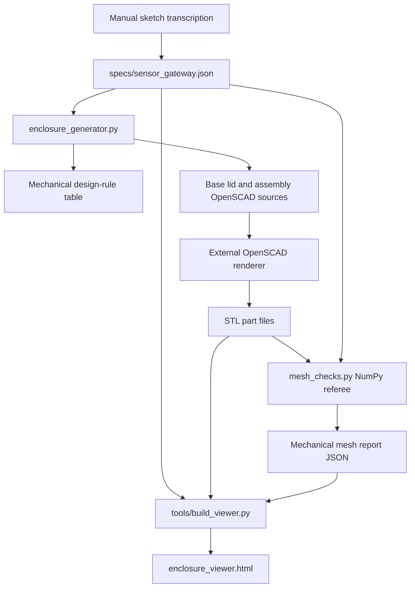
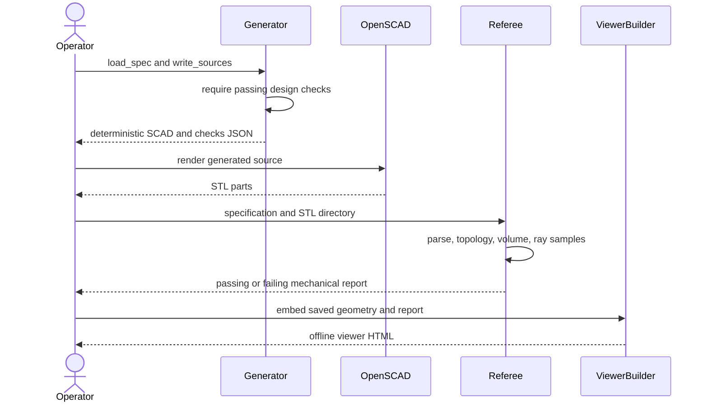

# Sensor enclosure CAD architecture

Reviewed against the local working tree on 2026-11-08. Source paths below are relative to this repository.

## System context and data flow

A millimetre JSON specification transcribes a documented sketch. Python validates design rules and emits deterministic OpenSCAD sources. OpenSCAD produces STL parts outside the generator. A NumPy referee checks actual meshes, while a generated offline browser viewer presents geometry and check results.



## Main execution sequence



## Modules and ownership

- `enclosure_generator.py` owns schema/provenance checks, boss/port geometry, design limits, source generation for base/lid/assembly, and source-export CLI.
- `mesh_checks.py` parses binary or ASCII STL into indexed NumPy arrays. It checks directed edges, manifoldness, signed volume, bounds, ray-sampled wall thickness, ports, bosses, and lid holes.
- `specs/sensor_gateway.json` owns nominal dimensions and sensor presets. `cad/` and `stl/` are saved build artifacts.
- `tools/build_viewer.py` and `viewer/enclosure_viewer.template.html` own offline visualization. `tools/render_stl.py` supplies render utilities.
- `tools/verify.py` and `tools/package_release.py` cross-check/package evidence. Python tests distinguish source/design checks from actual mesh checks.

## State and failure handling

The specification and saved meshes are file snapshots. `Mesh` owns deduplicated coordinates and triangle indices. Binary/ASCII readers round vertices to four decimals before indexing, which is part of the current topology tolerance. A mesh can be closed but have reversed winding, so positive signed volume is a separate gate. Ray hits normalize direction and deduplicate near-identical intersections. Source export requires passing design checks before writes. Missing parts produce failed report entries. The browser maintains camera, section, exploded-view, and selection state locally.

## Reproduce the checks

```sh
python -m pytest -q
python enclosure_generator.py --spec specs/sensor_gateway.json --out cad
python mesh_checks.py --spec specs/sensor_gateway.json --stl-dir stl --out reports/local-mechanical.json
```

The added tests use independently constructed tetrahedra, ray-scale invariance, real mesh CLI reports, and missing-part failure reporting. Fresh STL generation requires OpenSCAD. The checks do not establish real board fit, printability, strength, or ingress protection.

## Source crosscheck, 2026-11-08

The JSON loader currently validates only part of the mechanical schema. mesh_checks performs numerical triangle and ray checks on generated meshes. Source-level and mesh tests do not establish manufacturing fit or real sensor calibration.
