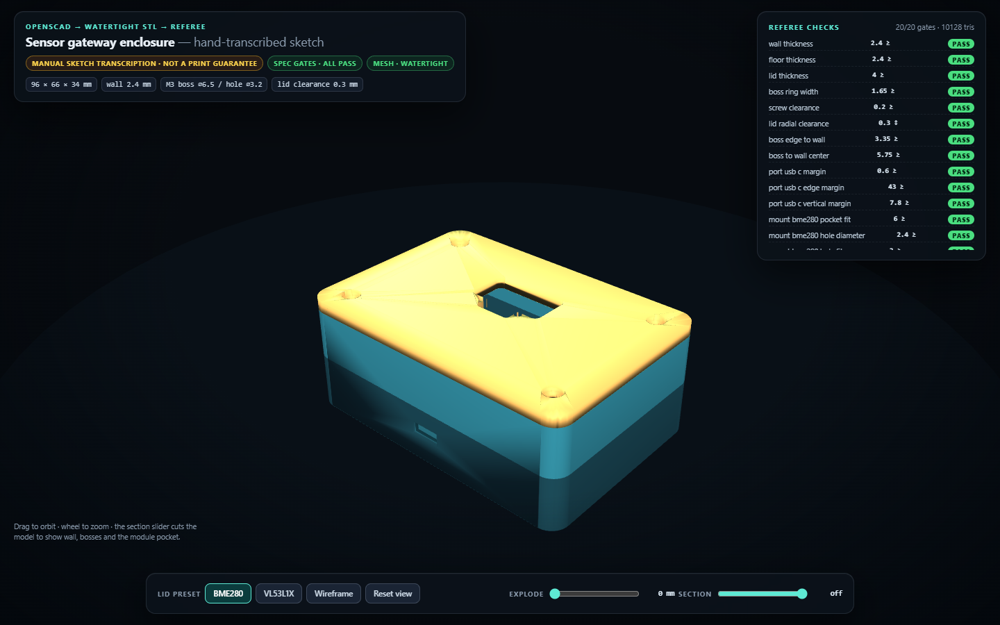
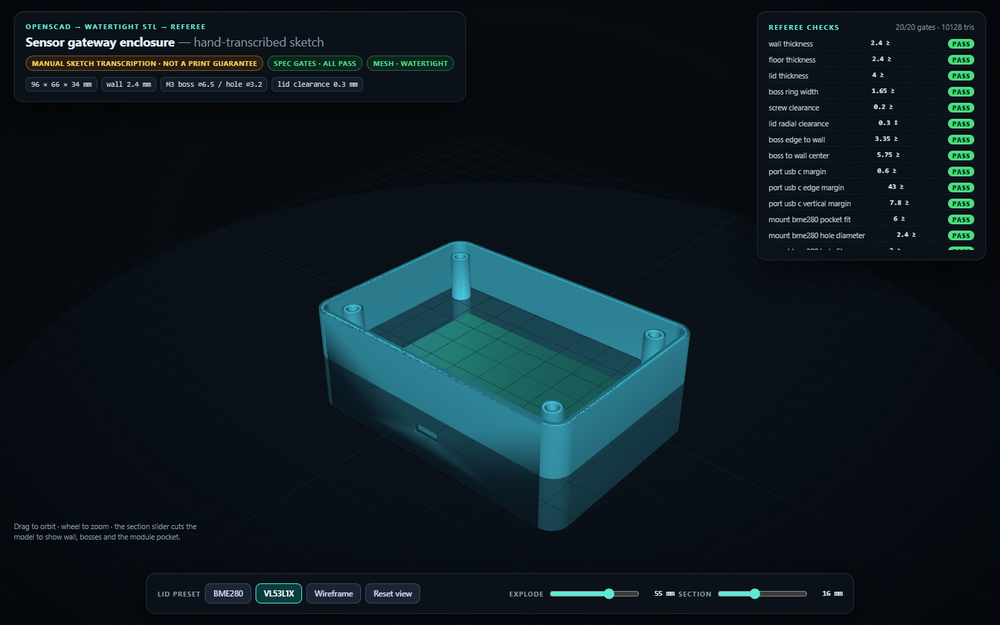

# Sensor enclosure CAD — hand sketch → parametric OpenSCAD → verified STL

A small CAD pipeline that turns a **documented hand transcription** of a napkin sketch into deterministic OpenSCAD sources, renders manifold STL parts, and runs a geometric referee on the result.



No photograph, OCR or vendor drawing is included. No physical print was made. Nothing here is a manufacturability, strength, ingress or drop guarantee.

## What it does

**1. Spec and referee gates (`enclosure_generator.py`)**

- Reads a millimetre spec with explicit provenance (`manual_sketch_transcription`).
- Evaluates **20 mechanical checks**: wall, floor and lid thickness, screw-boss ring, lid lip clearance, boss-to-wall margin, port clearance and edge margins, sensor-mount hole spacing and diameter, minimum feature size and corner radius.
- Refuses to emit CAD when a gate fails. No silent correction.

**2. Deterministic OpenSCAD output**

- Emits `cad/base.scad`, `cad/lid_bme280.scad`, `cad/lid_vl53l1x.scad` and `cad/assembly_bme280.scad`.
- Same spec in, byte-identical sources out — `tools/verify.py` regenerates them and compares against the committed files.
- Bosses are unioned **after** the cavity subtraction, so they stand on the floor instead of being cut away.

**3. Real OpenSCAD renders (`tools/render_stl.py`)**

- Calls the OpenSCAD 2021.01 CLI with `--export-format binstl`.
- Produces `stl/base.stl`, two lid presets and an assembly.
- Rendering is local: the committed STLs are the evidence, and CI checks those artifacts rather than re-running OpenSCAD.

**4. Mesh referee (`mesh_checks.py`)**

- Welds vertices, checks every edge is shared exactly twice with consistent winding, rejects degenerate triangles, and computes signed volume and bounding box.
- Casts rays to measure **wall thickness on four sides**, confirm the USB-C opening actually penetrates the wall, verify the motherboard-side edge stays solid, and confirm the boss hole is blind at the designed depth.
- 17 mesh checks in total.

**5. Standalone viewer (`enclosure_viewer.html`, generated)**

- Embeds three.js and all three meshes; opens from disk with no server or CDN.
- Orbit/zoom, lid-preset switch (BME280 / VL53L1X), exploded view, section plane through the model, wireframe toggle, and the live check table.
- Illustrative PCB block appears only in exploded view; it is not a board model.



## Design

| Parameter | Value |
| --- | --- |
| Outer envelope | 96 × 66 × 34 mm |
| Wall / floor / lid | 2.4 / 2.4 / 4.0 mm |
| Corner radius | 6 mm |
| Lid lip | 3 mm tall, 2 mm thick, 0.3 mm radial clearance |
| Fasteners | 4 × M3 heat-set bosses, ⌀6.5 boss, ⌀3.2 hole, 8 mm deep |
| USB-C opening | 10 × 4.4 mm (8.8 × 3.2 connector + 0.6 mm per side) |
| OLED window | 26 × 14 mm, R2 |
| Sensor presets | BME280 (12 × 8 aperture, 14 mm hole spacing) and VL53L1X (8 × 8, 9 mm spacing) |

## Verification

| Check | Result |
| --- | --- |
| `pytest` | 47 passed |
| Spec gates | 20 / 20 pass |
| Mesh checks | 17 / 17 pass |
| Base / lid / assembly watertight | yes, 0 boundary and 0 non-manifold edges |
| Triangles (base / lid / assembly) | 2,608 / 3,800 / 6,136 |
| Volumes | 42,039.8 / 24,836.4 / 66,876.2 mm³ |
| Assembly volume vs sum of parts | equal within 0.1 % |
| Measured wall thickness | 2.40 mm on all four sides |
| USB-C opening | penetrates the front wall; first hit 68.6 mm inside |
| Boss hole | blind, first hit 10 mm below the rim; ring material present |
| Browser QA (Chromium/SwiftShader) | 0 console errors; preset, explode, section and wireframe exercised |
| Viewer payload vs committed mesh report | triangle total matches |
| External assets / network fetch | none |

`reports/mechanical-report.json` holds the per-part evidence, `reports/verification.json` the chain report, and `docs/browser-qa.json` the browser run.

## Run it

Python 3.11+ with `numpy`; OpenSCAD only for re-rendering.

```sh
python enclosure_generator.py --spec specs/sensor_gateway.json --out cad
python tools/render_stl.py                 # needs OpenSCAD 2021.01+
python mesh_checks.py --spec specs/sensor_gateway.json
python tools/build_viewer.py
start enclosure_viewer.html
```

Tests and checks:

```sh
python -m pytest -q
python tools/verify.py
python tools/package_release.py
```

Browser QA (optional): `npm ci && npx playwright install chromium && npm run qa`.

## Limits

- The sketch is a **manual transcription**; no source image is shipped and no dimension was measured from a real board.
- No STEP/IGES export, no FEA, no tolerance stack-up analysis, no thermal or EMI analysis.
- No printed prototype, screw test, snap-fit test or IP rating. Snap-fit is not implemented.
- The clearance gates are parameter and mesh checks, not a guarantee of fit against a physical connector.
- Section clipping is a visual aid, not a manufacturable section drawing.
- OpenSCAD output depends on the pinned 2021.01 series; a different version may reorder facets while keeping the same geometry.

## Provenance and licence

All dimensions come from a hand-written example sketch for teaching. The design was generated and checked with AI assistance, then rendered and tested locally. No third-party hardware model is redistributed.

MIT — see [LICENSE](LICENSE).
